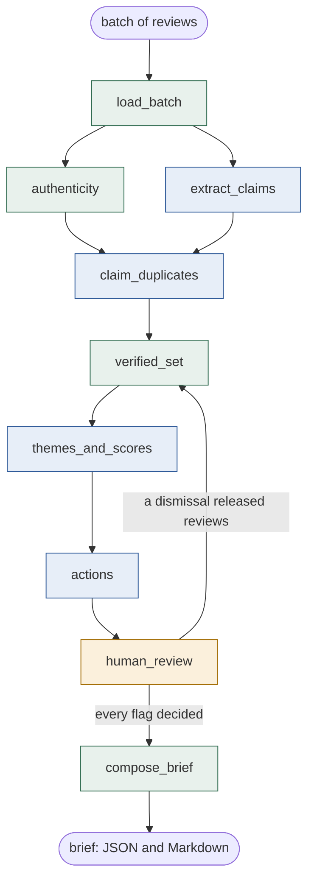

# Review Synthesizer

Turns a batch of guest reviews for an independent lodging property into an operator brief: ranked themes, an aspect scorecard, a prioritized action list, and an authenticity layer that flags coordinated review manipulation and computes a verified rating from the reviews that pass. A person confirms or dismisses every flag before the brief is final.

Started as an Arizona State University project (CIS 576, summer 2026). This repository carries that prototype forward into a production style build.

## Status

| Component | Capstone (v1) | v2 (this repository) |
|---|---|---|
| Detector | Rule based, in browser JavaScript: Jaccard near duplicate text at 0.55, rating bursts of 3 same rating reviews within 4 days | Python package with tests: the rules, sentence embeddings for light rewrites, a classifier trained on labeled hotel reviews, a stated reason and a confidence band on every flag (done) |
| Synthesis | Keyword rules in the demo; the LLM version lived in a Google AI Studio system prompt | Claude inside a LangGraph graph, claim level duplicate detection, a computed scorecard, and a human approval step (done, step 5) |
| Data | 25 synthetic reviews for a fictional property | CSV import, Postgres with pgvector, public hotel review datasets for development and evaluation |
| Backend | Designed in Module 4 (relational schema with row level security), never wired to the UI | FastAPI service, Docker Compose, MCP server for the detector (step 6) |
| Evaluation | Six structured test cases | Measured results for every signal under `evals/results/`; LangSmith tracing and CI (step 7) |

The v1 artifacts are kept unchanged under `prototype/`.

## Agent design

### What it does and who it is for

The operator of a small inn or independent hotel gets a few dozen reviews a month and no analyst. The agent reads a batch of reviews for one property and returns a one page brief: what guests keep raising, how each aspect of the stay scores, what to fix first, and which reviews look coordinated, with the rating recomputed without them. Every authenticity flag goes to the operator with its reason; nothing is final, posted or removed without a person.

### How it is built

One LangGraph graph over a typed state (`src/review_synthesizer/graph/`). The input is validated, then two branches run in parallel: the deterministic detector and claim extraction by a model. They join at claim duplicate detection, which compares what reviews claim rather than how they are worded. From there the graph runs in sequence: the verified set and rating, themes and scorecard, actions, then a LangGraph interrupt where the operator confirms or dismisses each flag. A dismissal releases its reviews and the synthesis reruns on the larger verified set; the brief is composed only after every flag is decided. There is no retrieval: the batch is the whole context, carried in the state, and the state is checkpointed so a run can pause for the operator and resume.



| Node | Kind | What it does |
|---|---|---|
| `load_batch` | code | Validates ids, ratings, dates and text; every problem reported at once |
| `authenticity` | code (local models) | The detector: word overlap, rating bursts, sentence embeddings, the deceptive language classifier |
| `extract_claims` | model (Claude Sonnet 5.5) | One structured call per review: its claims by aspect and polarity |
| `claim_duplicates` | code, then model (Claude Haiku 5.5) | Candidate pairs by shared specific claims in code; one small model judgment per candidate |
| `verified_set` | code | Reviews not held by a flag, displayed and verified ratings |
| `themes_and_scores` | model, then code | The model proposes themes, one evidence line per aspect, and serious issues; scores are computed from the claims; every citation and quote is checked |
| `actions` | model, then code | Up to five actions, each tied to verified reviews, ranked in code by impact then effort |
| `human_review` | person | LangGraph interrupt: confirm or dismiss each flag |
| `compose_brief` | code | The brief as JSON and Markdown, with a methods note: signals, thresholds, models, who decided the flags, run id |

Model output is always a validated schema, never free text in the state. Cited review ids must be verified reviews, quoted phrases must appear in the cited review, and what fails is dropped and counted in a note on the brief.

### Key design decisions and their trade offs

**Deterministic detection and a human gate before anything is final.** The signals that decide which reviews count are code and local models with stated thresholds, not a model's judgment, and every flag waits for a person. That trades throughput (a brief cannot finish unattended) for no unreviewed output: no review is set aside, and no rating changes, without someone having read why.

**Compute what can be computed; let the model do only what needs a model.** The aspect scorecard is the example. When the model chose scores, they moved between runs on the same reviews (cleanliness 1 in one run and 3 in the next, from one mold report). Now each review's stance per aspect comes from its extracted claims, the score follows from the share of negative stances by a fixed rule, and the model only writes the evidence line. Serious issues (health, safety, a stay cut short) are a separate checked list rather than a score override. Scores now agree across runs; themes, which still need a model, vary more (see below).

### How it was tested and evaluated

The test suite runs without network and without a key: every model call goes through a fake client that returns fixed structured output. The golden tests replay the capstone demo and must stay green. Each capability has a measured result under [`evals/results/`](evals/results/), with its limits stated next to it ([`docs/evaluation.md`](docs/evaluation.md)).

- **Deceptive language classifier**: 88.2% accuracy and ROC AUC 0.953 at p ≥ 0.5, and 99.1% precision at 42% recall at the p ≥ 0.8 operating point, on the Ott corpus with hotel disjoint folds ([ott_classifier.md](evals/results/ott_classifier.md)).
- **Embedding similarity**: at a cosine threshold of 0.85 it joins the planted light rewrite cluster on all three models tested (pairwise minimum 0.977 on the default model) and none of the 18 heavy paraphrase pairs; negative control PASS, with the most similar genuine pair at 0.801 and the most similar non duplicate at 0.703 ([paraphrase_similarity.md](evals/results/paraphrase_similarity.md)).
- **Claim duplicates** at the default (2 shared specific claims, strict judge): 3 of 18 rewritten pairs joined in each of two runs, and no wrong join on 258 paraphrase set negatives or 190 honest pairs of one property. The default is an author decision that overrides the ablation's recall rule, after the production prompt joined honest reviews under the looser setting ([claim_duplicates_default.md](evals/results/claim_duplicates_default.md), [claim_duplicates_ablation.md](evals/results/claim_duplicates_ablation.md)).
- **End to end** on the Harbor Light fixture with every signal on and every flag confirmed automatically: displayed 3.8, verified 3.5, the golden result, with no genuine review flagged, in both runs ([run_graph_harbor_light.md](evals/results/run_graph_harbor_light.md), [brief](evals/results/brief_harbor_light.md)).
- **Synthesis stability**, two runs before and two after the scorecard change on the same reviews: aspect scores equal on 10 of 10 aspects (8 of 10 before); themes with identical review sets 3 per pair (8 before), a documented limit ([run report](evals/results/run_graph_harbor_light.md), synthesis variance).
- **Cost**: $0.14 per 25 review brief, measured in both runs: 27 Claude Sonnet 5.5 calls (about 35,700 input and 7,000 output tokens) and two or three Claude Haiku 5.5 calls, at list prices as of 2026-10-06.

### Demo

Demo link: to come with deployment (step 8).

## Layout

```
src/review_synthesizer/authenticity/   the detector: rules, embedding similarity, classifier, one detect() call
src/review_synthesizer/graph/          the LangGraph graph: state, nodes, prompts, checks, scorecard, run_brief()
src/review_synthesizer/data/           fetch and normalise public evaluation data
src/review_synthesizer/evals/          evaluation harnesses; results are committed under evals/results/
scripts/                                command line entry points, including the live evaluation scripts
tests/                                  tests, golden tests on the capstone data set, fake model client
prototype/                              v1 single file prototype and the AI Studio system prompt
db/                                     Postgres schema (Module 4 base) and v2 migrations
docs/                                   build plan, evaluation protocol and results, data sources and terms
```

## Install and run

```
python -m venv .venv
.venv\Scripts\activate        (Windows)   |   source .venv/bin/activate   (macOS, Linux)
pip install -e .[dev,ml,embeddings,graph]
python -m pytest
```

The tests need no network and no API key. The golden tests replay the capstone demo: the five planted reviews are flagged, none of the twenty genuine ones are, and the rating moves from 3.8 displayed to 3.5 verified.

From code, one call runs the graph; `approve` is the person in the loop and receives every flag with its reason:

```python
from review_synthesizer.graph import run_brief
brief = run_brief(reviews, "Harbor Light Inn", approve=my_review_callback)
print(brief.markdown)
```

Live scripts call the Claude API, need `ANTHROPIC_API_KEY` in `.env` (copy `.env.example`), and spend credit:

```
python scripts/run_graph.py      # the whole graph on the Harbor Light fixture, every flag confirmed automatically
python scripts/eval_claims.py    # claim duplicates on the paraphrase set and the same property control
```

The Messages API rejects sampling parameters (temperature, top_p, top_k), so the graph sends none and run to run stability is measured by repeating runs, as the reports above do.

## Detector signals

| Signal | What it catches | How it is measured |
|---|---|---|
| `duplicate_phrasing` | Copy and paste with light edits: Jaccard word overlap at or above 0.55 | Golden tests on the capstone data set |
| `rating_burst` | Three or more same rating reviews within four days; separate bursts reported separately | Golden tests |
| `embedding_similarity` | Light rewrites: cosine similarity of sentence embeddings at or above 0.85 (paraphrase-mpnet-base-v2, runs locally). Heavy paraphrase is not separable from honest reviews on the same topic by any of three models tested, and at 0.85 none of it is joined | `evals/results/paraphrase_similarity.md`, with a negative control |
| `deceptive_language` | Language that resembles reviews written without a stay; flagged only at p ≥ 0.8 | 99.1% precision, 42% recall on the Ott corpus, `evals/results/ott_classifier.md` |
| `claim_duplicate` (graph) | Reviews that make the same specific claims in different words: candidates share at least two specific claims, then a small model judges each pair | 3 of 18 rewritten pairs, no wrong join on either negative set, `evals/results/claim_duplicates_default.md` |

Every flag carries a score, a confidence band and a written reason, and is a signal for human review rather than a verdict. Bands follow the margin over the signal's own threshold; claim duplicates are banded by the number of shared claims behind the join, and the rating burst keeps a provisional mapping of its score. Try the detector on the capstone data set:

```
python scripts/detect.py tests/fixtures/harbor_light_inn.json
python scripts/detect.py tests/fixtures/paraphrase_set.json --embeddings --classifier models/ott_deception.joblib
```

## Evaluation

The protocol and every result, with its limits, are in [`docs/evaluation.md`](docs/evaluation.md). Reproduce the offline evaluations with:

```
python scripts/fetch_ott_corpus.py      # once; the corpus is not redistributed (docs/data.md)
python scripts/eval_ott.py
python scripts/eval_similarity.py --model sentence-transformers/paraphrase-mpnet-base-v2 --model sentence-transformers/all-MiniLM-L6-v2 --model sentence-transformers/all-mpnet-base-v2
```

The claim duplicate and end to end evaluations are the live scripts above.

## Notes

- The demo properties, Harbor Light Inn and Birch Point Hotel, are fictional, as are all reviews in the fixtures. No real business or reviewer data is used.
- Authenticity output is a probabilistic signal for human review, not a verdict. Nothing in this system accuses a reviewer or triggers a takedown.
- Secrets are never committed. Copy `.env.example` to `.env` locally.
